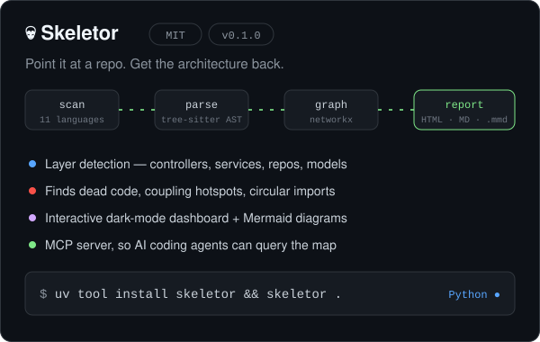
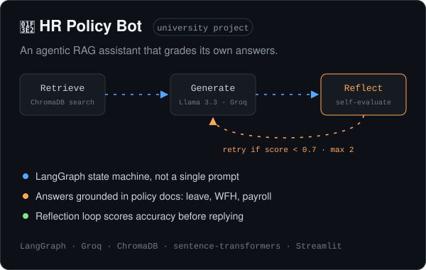
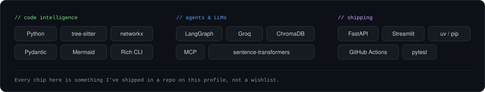
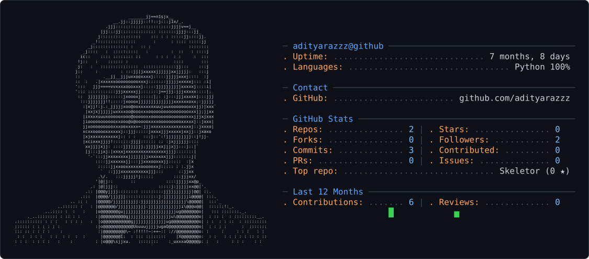

### Hey, I'm Aditya 👋

Most of the code people work on was written by someone else, and most of it has no map. I like building the map.

- 💀 Right now I'm building **[Skeletor](https://github.com/adityarazzz/Skeletor)**, which statically analyses a codebase and gives back its architecture: layers, dependency graph, cycles and dead code.
- 🤖 I'm into **agentic AI** that checks its own work: graphs of retrieve → generate → reflect steps rather than one big prompt.
- 🔌 I care about making these tools usable **by AI coding agents as well as people**, which is why Skeletor ships an MCP server.
- 🏢 Member of **Stemple Pvt Ltd**.

 

### What I've built

  
  

Skeletor is open source (MIT). HR Policy Bot is a private university project. Ask me about it.

  

### Toolbox

 

### At a glance

<picture>
  <source media="(prefers-color-scheme: dark)" srcset="dark_mode.svg" />
  <source media="(prefers-color-scheme: light)" srcset="light_mode.svg" />
  
</picture>

 

### Let's talk

I'm happy to talk about code analysis, agent tooling or RAG systems that actually hold up.

